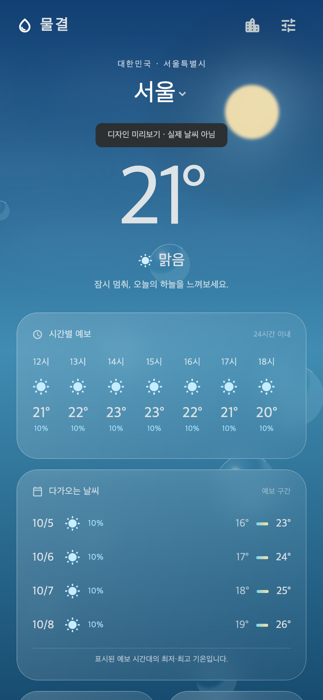

# 물결 · Weather

기상청 날씨를 물방울 같은 화면으로 만나는 **Flutter Android + SwiftUI iPhone** 앱.

**Power by 기상청** · [기상청 단기예보 조회서비스](https://www.data.go.kr/data/15084084/openapi.do)

- **Android:** Flutter / Dart, 흐린 유리 카드, Canvas 날씨·물방울 애니메이션
- **iPhone:** Swift / SwiftUI, iOS 26+ 네이티브 Liquid Glass 컨트롤, iOS 17+ 반투명 머티리얼 대체 구현
- **데이터:** 기상청 초단기실황·초단기예보 + 단기예보. 기기에서 직접 연결하거나 선택적으로 서버 사용
- **화면:** 국내 12개 도시 검색, 현재 위치, 현재 기온, 6시간 갱신 초단기예보, 24시간 시간별·날짜별 예보(요일 포함), 습도, 풍향·풍속, 강수량·강수확률, 적설·파고·낙뢰(제공 시)
- **위젯:** Android 홈 화면, iPhone 홈 화면 및 잠금 화면. 앱이 최신 날씨를 불러오면 위젯도 갱신
- **모션:** 낮/밤 하늘, 햇빛/달빛, 구름, 비, 눈, 진눈깨비, 물방울 하이라이트. 시스템 동작 줄이기 지원
- **버전:** `VERSION`을 기준으로 최초 커밋 `1.0.0`, 이후 커밋마다 패치 +1, `vX.Y.Z` 태그

> 인증키가 없어도 앱의 **먼저 둘러보기 / 설정 → 디자인 미리보기**에서 디자인을 확인할 수 있습니다. 미리보기에는 ‘실제 날씨 아님’이 표시됩니다. 실제 날씨를 보려면 설정에 기상청 일반 인증키(Decoding)를 입력하세요. 키는 Android 보안 저장소 또는 iPhone Keychain에 저장되며, 서버 없이 휴대폰에서 직접 연결합니다.



## 소스 구성

```text
android_app/    Flutter 소스, Android Gradle 프로젝트, 테스트
ios_app/        SwiftUI 소스, Xcode 프로젝트, XCTest, XcodeGen 명세
server/         기상청 API 어댑터와 HTTP 서버 (Python 표준 라이브러리)
scripts/        버전 동기화, Git hooks 설정, 원본 아이콘 생성 코드
.githooks/      커밋별 자동 버전 증가 / 태그 생성
.github/        Python·Flutter·Xcode CI
```

## 1. 기상청 인증키 발급

1. [공공데이터포털의 기상청_단기예보 조회서비스](https://www.data.go.kr/data/15084084/openapi.do)에 로그인합니다.
2. **활용신청**을 누르고 개발계정을 신청합니다.
3. 승인된 서비스의 **일반 인증키(Decoding)**를 확인합니다. 이 앱은 API허브의 `authKey`가 아닌 공공데이터포털 `serviceKey`를 사용합니다.
4. 승인된 **일반 인증키(Decoding)**를 앱 설정의 인증키 칸에 입력합니다. 앱은 Android 보안 저장소 또는 iPhone Keychain에 저장하고 기기에서 기상청으로 직접 요청합니다. 서버를 따로 운영한다면 아래 선택 절차를 이용하세요. 키를 GitHub에 올리지 마세요.

```sh
cp server/.env.example server/.env
# 편집기로 server/.env를 열어 KMA_SERVICE_KEY 입력
python3 -m server.app
```

Python 3.11 이상이 필요합니다. 별도 Python 패키지는 필요하지 않습니다.

```sh
curl http://127.0.0.1:8080/health
curl 'http://127.0.0.1:8080/v1/weather?lat=37.5665&lon=126.978'
```

인증키가 없으면 `503`과 설정 안내를 반환합니다. 인증키/활용승인/할당량 오류는 실제 날씨나 예시 데이터로 위장하지 않습니다.

Mac에서 앱을 계속 사용할 때는 로컬 서버를 로그인 시 자동 시작하도록 등록할 수 있습니다. 설치 명령은 `server/.env`를 개인용 Application Support 폴더에 복사해 권한을 제한합니다. GitHub에는 복사된 키가 올라가지 않습니다.

```sh
python3 scripts/local_server.py install
python3 scripts/local_server.py status
# 중지·등록 해제: python3 scripts/local_server.py remove
```

서버 소스나 인증키를 바꿨다면 `install`을 다시 실행해 로컬 서비스를 갱신하세요.

## 2. Android 실행

Flutter 3.44.1 / Dart 3.12 / JDK 21 / Android SDK가 기준입니다. 앱 설정에서 기상청 일반 인증키를 입력하면 서버 주소 없이 휴대폰에서 직접 연결합니다.

```sh
cd android_app
flutter pub get
flutter run --dart-define=WEATHER_API_URL=http://10.0.2.2:8080
```

기상청 인증키를 앱 설정에 저장하면 직접 연결이 우선됩니다. 앱 설정에서 인증키를 비우고 HTTPS 서버 주소를 입력하면 자체 서버를 사용할 수 있습니다. Debug 빌드는 개발용 로컬 주소도 지원합니다.

```sh
flutter build apk --debug
# 결과: build/app/outputs/flutter-apk/app-debug.apk
```

배포용 빌드는 소유자의 keystore 및 Android 서명 설정이 추가로 필요합니다. 현재 Flutter 기본 디버그 서명은 스토어 배포용이 아닙니다.

## 3. iPhone 실행

`ios_app/Weather.xcodeproj`를 Xcode에서 열고 `Weather` 스킴과 시뮬레이터를 선택해 실행합니다. **Flutter iOS 래퍼가 아닌 별도의 네이티브 SwiftUI 앱**입니다. CocoaPods는 필요하지 않습니다.

- 최소 iOS 17.0. Xcode 16에서도 머티리얼 대체 구현으로 빌드할 수 있습니다.
- 네이티브 `glassEffect`는 Xcode 26+ SDK / Swift 6.2+ 컴파일러와 iOS 26+에서 활성화됩니다.
- 앱 설정에서 기상청 일반 인증키(Decoding)를 입력하면 서버 없이 직접 연결합니다. 키는 Keychain에 저장됩니다. 앱에서 날씨를 불러온 다음 홈 화면 또는 잠금 화면에서 위젯을 추가하면 됩니다. 위젯은 마지막으로 불러온 날씨를 표시합니다. 또는 인증키 없이 HTTPS 서버 주소를 입력할 수 있습니다.
- 실기기 설치/배포는 Xcode Signing & Capabilities에서 본인의 Apple 개발 팀을 지정합니다.
- Xcode 프로젝트는 저장소에 포함되어 있으며, 명세를 수정할 때만 `xcodegen generate --spec ios_app/project.yml`로 재생성합니다.

```sh
xcodebuild -project ios_app/Weather.xcodeproj -scheme Weather \
  -destination 'generic/platform=iOS Simulator' CODE_SIGNING_ALLOWED=NO build
```

## 4. 서버 배포

```sh
docker build -f server/Dockerfile -t weather-api .
docker run --env-file server/.env -e HOST=0.0.0.0 -p 8080:8080 weather-api
```

실기기에서 인터넷으로 이용하려면 HTTPS를 제공하는 서버 환경에 배포하고 앱 설정에 주소를 입력합니다. 도메인·호스팅 배포는 이 저장소 생성 작업에 포함되지 않았습니다. 현재 서버는 개인 사용/개발용 표준 라이브러리 서버입니다. 공개 서비스로 운영할 때는 TLS reverse proxy, 요청 제한, 사용자 인증, 공용 캐시 및 서버 모니터링을 추가하세요.

## 버전과 계정 커밋

```sh
sh scripts/setup.sh
# 본인의 GitHub 계정에 연결된 Git author를 사용
# 이 저장소 최초 작성자: limhiru / 285737129+limhiru@users.noreply.github.com
git add .
git commit -m 'feat: 변경 내용'
git push
```

설치된 hook이 첫 커밋은 `1.0.0`, 다음부터 `1.0.1`, `1.0.2`처럼 자동 증가시키고 Android·iOS 버전과 빌드 번호를 함께 갱신합니다. post-commit hook은 annotated `vX.Y.Z` 태그를 만들고 `push.followTags`로 함께 전송합니다. 새 clone에서는 hooks가 자동 실행되지 않으므로 `scripts/setup.sh`를 한 번 실행해야 합니다. GitHub 웹 편집은 로컬 hooks를 실행하지 않으므로 버전 CI가 불일치를 검출합니다. 이미 배포한 커밋은 amend 대신 새 커밋을 만드세요.

## 검증

[검증 결과와 확인이 필요한 범위](docs/VERIFICATION.md)를 참고하세요.

```sh
python3 -m unittest discover -s server/tests -v
python3 scripts/version.py --check
cd android_app
flutter analyze
flutter test
flutter build apk --debug
```

Xcode에서는 Product → Test로 KST 날짜 변환, 서버 주소 검증, 데이터 모델 테스트를 실행합니다. 실제 기상청 호출 검증은 사용자 인증키를 등록한 후 진행해야 합니다. GPS 실제 위치 권한 및 App Store/Play 배포는 실기기/개발자 계정에서 추가 확인해야 합니다.

## 데이터 표시 원칙

- 대한민국 영역 내 좌표를 기상청 5km DFS 격자로 변환합니다.
- 모든 발표일·시각과 화면 시간은 기기 시간대와 관계없이 KST입니다.
- 초단기실황은 매 정시 자료를 40분 이후, 단기예보는 02/05/08/11/14/17/20/23시 자료를 10분 이후 조회합니다. 발표 지연은 오류로 안내합니다.
- 같은 격자의 성공 응답은 서버에서 5분 동안 캐시합니다. 관측 시각은 화면에 표시합니다.
- 현재의 하늘 상태는 관측 강수 형태와 가장 가까운 예보의 SKY를 조합합니다. 기온/습도/풍속/강수량은 실황입니다.
- 화면에는 최대 24시간의 시간별 예보와 API가 제공하는 날짜별 예보를 표시합니다. TMN/TMX가 있으면 공식 일 최저·최고를 사용하고, 없을 때만 수신한 시간별 예보 범위를 사용합니다. 3시간 이내 강수확률 최고값으로 우산 안내를 제공합니다. 공기질·자외선·일출/일몰은 이 단기예보 API가 제공하지 않아 표시하지 않습니다.
- 날짜별 예보 옆에 한국어 요일을 표시합니다. 현재 단기예보 API 이후 기간은 기상청 [중기예보 조회서비스](https://www.data.go.kr/data/15059468/openapi.do)가 제공하는 11일 전망으로 확장할 수 있습니다. 중기예보는 별도 활용 신청 및 연동이 필요하며, 이 앱은 아직 해당 API를 호출하지 않습니다.
- 누락값은 `—`로 표시합니다. 실패 후 이전 화면 자료가 남아 있으면 별도 안내를 표시합니다.
- 현재 위치는 사용자가 눌렀을 때만 요청하며 서버 로그에는 좌표를 남기지 않습니다. 선택 도시와 서버 주소만 기기에 저장합니다.

## 디자인 참고와 출처

- [Apple 날씨 앱](https://support.apple.com/guide/iphone/check-the-weather-iph1ac0b35f/ios)의 큰 기온 타이포그래피와 예보 정보 계층을 참고했습니다.
- [Apple Liquid Glass 문서](https://developer.apple.com/documentation/SwiftUI/Applying-Liquid-Glass-to-custom-views)를 따라 최신 iPhone에서 컨트롤에 네이티브 유리 효과를 적용합니다.
- [Samsung One UI 모션 가이드](https://developer.samsung.com/one-ui/motion/basic.html)의 깊이감과 자연스러운 움직임을 참고했습니다. 하늘·물방울·비·눈은 이 프로젝트에서 코드로 직접 그립니다. Apple/Samsung 이미지나 앱 코드를 복제하지 않았습니다.
- 실제 데이터 출처: [기상청 / 공공데이터포털](https://www.data.go.kr/data/15084084/openapi.do), 공공누리 제1유형 출처표시.
